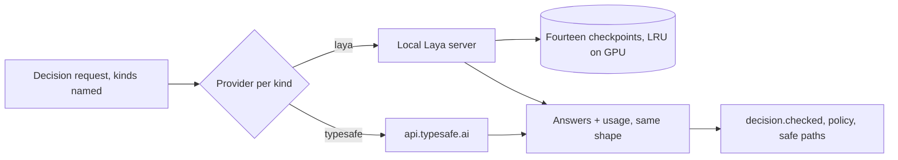

# Laya — replace Jev with fourteen fine-tuned decision models

Purpose. Replace the hosted Jev model (`jev-1.13.0`) with Laya models trained
on this repository's own decisions: one model per decision kind, chosen by
code. Every current guarantee stays: code owns permissions, budgets and
execution; uncertain answers take the existing safe path; modes stay off,
shadow and active. Research, sources and measurements are on
[the research page](../../research/laya-replacement.md).

## Decisions

| Decision | Choice | By |
| --- | --- | --- |
| Model | [Laya](https://huggingface.co/convaiinnovations/laya), Apache-2.0, fine-tuned locally | Owner, 2026-10-13 |
| Split | Fourteen models, one per decision kind; code routes by the kind each question already carries | Owner, 2026-10-13 |
| Training data | 3,000 states per kind to start; then augmentation of the slices validation gets most wrong | Owner, 2026-10-13 |
| Labels | Two LLM labellers independently; agreed labels train, disagreements go to a person | Owner, 2026-10-13 |
| Gate test | States production really sent, labelled by a person, reserved before any measurement; synthetic sets are diagnostics only | This plan |
| Runtime | Local server on the RTX 3080 (10 GB); TypeSafe stays as a per-kind fallback until rollout | This plan |
| Language | English states only, as Jev today; normalization is unchanged | Existing rule |

The fourteen kinds (`tool/decision/policy.py`):

| Form | Kinds |
| --- | --- |
| Noul (yes/no) | `route`, `source`, `useful`, `conflict`, `redirect`, `coverage`, `ask`, `analysis`, `progress` |
| Choice | `repair`, `relation`, `answers`, `faithful`, `action` |

## Architecture

A request that asks several kinds at once (a judge round asks useful,
conflict, redirect, coverage and repair) is grouped by provider: TypeSafe
questions stay one call, Laya questions go to each kind's model, and the
answers are joined in question order. The kinds reach the transport, the
request's `model` becomes the identity of the deciders it asked, the policy
is composed per kind, and one trace entry keeps every group's model and
usage. [Stage 1](1-serving.md) defines this contract and what happens to a
state over a kind's length limit (the whole request on TypeSafe with its
existing policy, else `unavailable`).

## Steps

| # | Step | Deliverable | Status |
| --- | --- | --- | --- |
| 1 | [Serving](1-serving.md) | Local server, per-kind provider, context and zero-shot baseline | Not started |
| 2 | [Data](2-data.md) | States per kind, splits, the gate test | Not started |
| 3 | [Labels](3-labels.md) | Two-labeller agreement, human queue, pilot then full run | Not started |
| 4 | [Training](4-training.md) | Fourteen fine-tunes, calibration, fitted policy | Not started |
| 5 | [Augmentation](5-augmentation.md) | Error-slice loop per kind | Not started |
| 6 | [Rollout](6-rollout.md) | Non-inferiority gates, shadow then active per kind | Not started |

Order: 1 → 2 → 3 → 4 → 5 → 6. Stage 1 first reserves the gate test, then
runs no paid call and decides whether the rest is worth paying for. Every
paid step needs the owner's approval with a stated budget before it sends
anything: teacher generation (stage 2), labelling (stage 3), augmentation
(stage 5) and the Jev comparison (stage 6); a repetition needs a second
approval. Route goes through stages 2–6 first; the other thirteen start
after route's stage 6 result.

## Relation to open work

- Reliability PR 9 (#135) is paused at review round 5. Its findings are in
  the set's substring label checker, which calls no model, so this plan does
  not resolve them. A trained `faithful` model could later replace that
  checker; that is PR 9's decision, not this plan's.
- Reliability PR 10 and the review-routing stages keep using whichever
  provider each kind is set to.

## Budget

| Item | Estimate | Gate |
| --- | --- | --- |
Per kind; fourteen kinds multiply it. Token figures assume about 2k input
tokens per call and are replaced by each pilot's measurement.

| Item | Per kind | Gate |
| --- | --- | --- |
| Teacher generation | 4,320 candidates: 3,600 usable targets (3,000 + 300 + 300) plus a 20% surplus per split (600 + 60 + 60) | Stage 2 pilot of 50, then owner approval |
| Labelling | Up to 4,320 × 2 = 8,640 labels, about 17.3M input tokens (about 242M for fourteen); labelling stops when the targets are met, so surplus is paid only for refills | Stage 3 pilot of 200, then owner approval of a total limit |
| Human review | The pilot's disagreement rate × the states labelled, capped | Cap set from the pilot |
| Augmentation | Up to 3 rounds × 300 states, generated and labelled twice | One approved total limit before round 1 |
| Training | About 1–3 GPU-hours locally, per run and per augmentation round | Local, no spend |
| Jev comparison | Up to 300 gate states | Owner approval; a repetition needs a second |

## Sources

See [the research page](../../research/laya-replacement.md), L1–L8.
