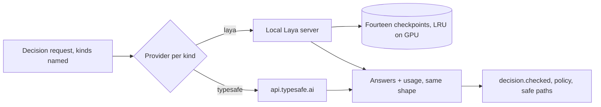

# Laya — replace Jev with fourteen fine-tuned decision models

Purpose. Replace the hosted Jev model (`jev-1.13.0`) with Laya models trained
on this repository's own decisions: one model per decision kind, chosen by
code. Every current guarantee stays: code owns permissions, budgets and
execution; uncertain answers take the existing safe path; modes stay off,
shadow and active. Research, sources and measurements are on
[the research page](../../research/laya-replacement.md).

## Decisions

| Decision | Choice | By |
| --- | --- | --- |
| Model | [Laya](https://huggingface.co/convaiinnovations/laya), Apache-2.0, fine-tuned locally | Owner, 2026-10-13 |
| Split | Fourteen models, one per decision kind; code routes by the kind each question already carries | Owner, 2026-10-13 |
| Training data | 3,000 states per kind to start; then augmentation of the slices validation gets most wrong | Owner, 2026-10-13 |
| Labels | Two LLM labellers independently; agreed labels train, disagreements go to a person | Owner, 2026-10-13 |
| Test sets | Real logged states and existing evaluation sets only, frozen before training, never trained on | This plan |
| Runtime | Local server on the RTX 3080 (10 GB); TypeSafe stays as a per-kind fallback until rollout | This plan |
| Language | English states only, as Jev today; normalization is unchanged | Existing rule |

The fourteen kinds (`tool/decision/policy.py`):

| Form | Kinds |
| --- | --- |
| Noul (yes/no) | `route`, `source`, `useful`, `conflict`, `redirect`, `coverage`, `ask`, `analysis`, `progress` |
| Choice | `repair`, `relation`, `answers`, `faithful`, `action` |

## Architecture

A request that asks several kinds at once (a judge round asks grade,
coverage and repair) is split by kind, sent to each kind's model, and joined
in question order. The contract after `evaluate` is unchanged, so policy,
cache, replay and traces need no new shape; the trace's `model` names the
kind's checkpoint and version.

## Steps

| # | Step | Deliverable | Status |
| --- | --- | --- | --- |
| 1 | [Serving](1-serving.md) | Local server, per-kind provider, context and zero-shot baseline | Not started |
| 2 | [Data](2-data.md) | States per kind, splits, frozen tests | Not started |
| 3 | [Labels](3-labels.md) | Two-labeller agreement, human queue, pilot then full run | Not started |
| 4 | [Training](4-training.md) | Fourteen fine-tunes, calibration, fitted policy | Not started |
| 5 | [Augmentation](5-augmentation.md) | Error-slice loop per kind | Not started |
| 6 | [Rollout](6-rollout.md) | Non-inferiority gates, shadow then active per kind | Not started |

Order: 1 → 2 → 3 → 4 → 5 → 6. Stage 1 runs no paid call and decides
whether the rest is worth paying for. Labelling (stage 3) and every paid
evaluation need the owner's approval with a stated budget; a repetition
needs a second approval. Route is the pilot kind through stages 2–6 before
the other thirteen follow.

## Relation to open work

- Reliability PR 9 (#135) is paused at review round 5. Its findings are in
  the set's substring label checker, which calls no model, so this plan does
  not resolve them. A trained `faithful` model could later replace that
  checker; that is PR 9's decision, not this plan's.
- Reliability PR 10 and the review-routing stages keep using whichever
  provider each kind is set to.

## Budget

| Item | Estimate | Gate |
| --- | --- | --- |
| Labelling, full | 42,000 states × 2 labellers, about 2k input tokens each, about 170M input tokens | Pilot first (stage 3); owner approval with the measured cost |
| Human review | The pilot's disagreement rate × 42,000, capped per kind | Cap set from the pilot |
| Training | 14 runs × about 1–3 GPU-hours locally | Local, no spend |
| Evaluation | Jev comparison on frozen tests: one paid run, one repetition | Owner approval each |

## Sources

See [the research page](../../research/laya-replacement.md), L1–L8.
